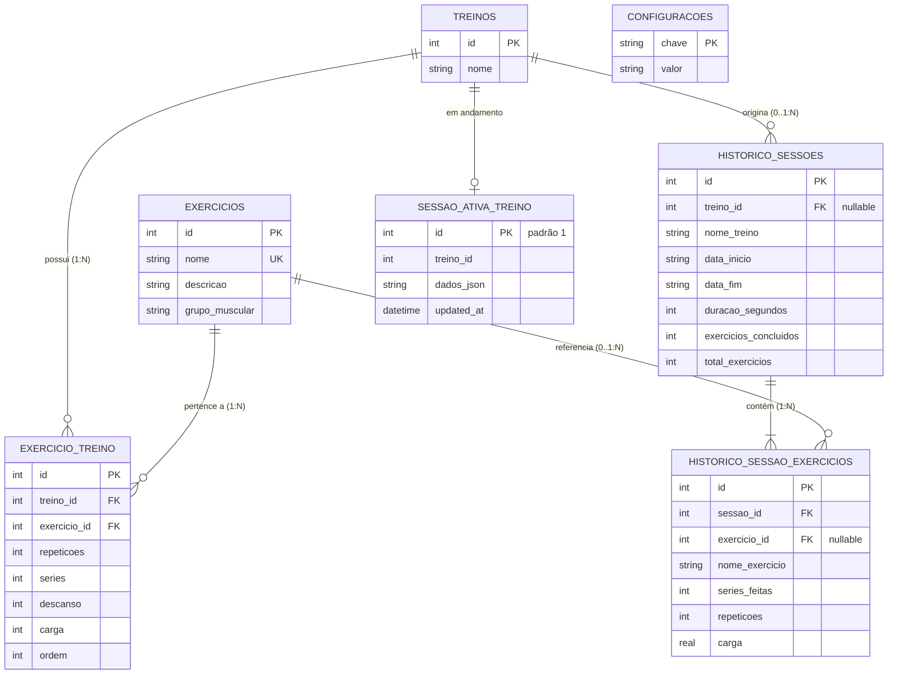

# 📊 Entidades do Sistema - MWE-TREINO

Este documento descreve as entidades de dados, estruturas TypeScript e tabelas SQLite utilizadas na aplicação **MWE-TREINO**.

---

## 📌 Sumário

1. [Visão Geral e Diagrama Entidade-Relacionamento](#-diagrama-entidade-relacionamento-er)
2. [Entidades Principais](#-entidades-principais)
   - [1. Exercício (`exercicios`)](#1-exercício-exercicio)
   - [2. Treino (`treinos`)](#2-treino-treino)
   - [3. Exercício do Treino (`exercicio_treino`)](#3-exercício-do-treino-exerciciotreino)
   - [4. Histórico de Sessão (`historico_sessoes`)](#4-histórico-de-sessão-historicosessao)
   - [5. Exercício da Sessão Histórica (`historico_sessao_exercicios`)](#5-exercício-da-sessão-histórica-historicosessaoexercicio)
3. [Entidades de Suporte e Estado](#-entidades-de-suporte-e-estado)
   - [6. Sessão Ativa de Treino (`sessao_ativa_treino`)](#6-sessão-ativa-de-treino-sessaoativatreino)
   - [7. Configurações (`configuracoes`)](#7-configurações-configuracao)
4. [Tipos e DTOs Auxiliares](#-tipos-e-dtos-auxiliares)

---

## 🗺️ Diagrama Entidade-Relacionamento (ER)



---

## 🧱 Entidades Principais

### 1. Exercício (`Exercicio`)
Representa o catálogo de exercícios físicos cadastrados na base (pré-carregados no banco ou adicionados pelo usuário).

* **Tabela SQLite:** `exercicios`
* **Definição TypeScript:** `src/types.ts`

```typescript
export interface Exercicio {
  id: number;
  nome: string;
  descricao?: string;
  grupo_muscular?: GrupoMuscular;
}
```

| Campo SQLite | Tipo SQLite | TypeScript | Restrições | Descrição |
| :--- | :--- | :--- | :--- | :--- |
| `id` | `INTEGER` | `number` | `PRIMARY KEY AUTOINCREMENT` | Identificador único do exercício |
| `nome` | `TEXT` | `string` | `NOT NULL UNIQUE` | Nome do exercício (ex: "Supino Reto com Barra") |
| `descricao` | `TEXT` | `string?` | `NULL` | Descrição ou instruções dos músculos envolvidos |
| `grupo_muscular` | `TEXT` | `GrupoMuscular` | `NOT NULL DEFAULT 'Geral'` | Categoria muscular (possui índice `idx_exercicios_grupo`) |

*Grupos Musculares suportados:* `Peitoral`, `Costas`, `Ombros`, `Bíceps`, `Tríceps`, `Pernas`, `Abdômen`, `Geral`.

---

### 2. Treino (`Treino`)
Representa a rotina de treino agrupada (ex: "Treino A - Peito e Tríceps", "Treino de Pernas").

* **Tabela SQLite:** `treinos`
* **Definição TypeScript:** `src/types.ts`

```typescript
export interface Treino {
  id: number;
  nome: string;
  exercicios?: ExercicioTreino[];
}
```

| Campo SQLite | Tipo SQLite | TypeScript | Restrições | Descrição |
| :--- | :--- | :--- | :--- | :--- |
| `id` | `INTEGER` | `number` | `PRIMARY KEY AUTOINCREMENT` | Identificador único do treino |
| `nome` | `TEXT` | `string` | `NOT NULL` | Nome dado ao treino |

---

### 3. Exercício do Treino (`ExercicioTreino`)
Entidade associativa entre um **Treino** e um **Exercício**, contendo a parametrização de séries, repetições, carga, descanso e ordenação de execução.

* **Tabela SQLite:** `exercicio_treino`
* **Definição TypeScript:** `src/types.ts`

```typescript
export interface ExercicioTreino {
  id: number;
  treino_id: number;
  exercicio_id: number;
  exercicio?: Exercicio;
  repeticoes: number;
  series: number;
  descanso: number;
  carga: number;
  ordem?: number;
}
```

| Campo SQLite | Tipo SQLite | TypeScript | Restrições / FK | Descrição |
| :--- | :--- | :--- | :--- | :--- |
| `id` | `INTEGER` | `number` | `PRIMARY KEY AUTOINCREMENT` | Identificador único da associação |
| `treino_id` | `INTEGER` | `number` | `NOT NULL`, `FK -> treinos(id) ON DELETE CASCADE` | ID do treino vinculado |
| `exercicio_id` | `INTEGER` | `number` | `NOT NULL`, `FK -> exercicios(id) ON DELETE CASCADE` | ID do exercício vinculado |
| `repeticoes` | `INTEGER` | `number` | `NOT NULL` | Quantidade alvo de repetições |
| `series` | `INTEGER` | `number` | `NOT NULL` | Quantidade de séries a executar |
| `descanso` | `INTEGER` | `number` | `NOT NULL` | Tempo de descanso entre séries (em segundos) |
| `carga` | `INTEGER` | `number` | `NOT NULL` | Carga planejada (em kg) |
| `ordem` | `INTEGER` | `number?` | `NOT NULL DEFAULT 0` | Ordem de execução do exercício dentro do treino |

---

### 4. Histórico de Sessão (`HistoricoSessao`)
Armazena o registro concluído de uma sessão de treino realizada pelo usuário, incluindo data/hora, duração e taxa de conclusão.

* **Tabela SQLite:** `historico_sessoes`
* **Definição TypeScript:** `src/types.ts`

```typescript
export interface HistoricoSessao {
  id: number;
  treino_id?: number | null;
  nome_treino: string;
  data_inicio: string;
  data_fim: string;
  duracao_segundos: number;
  exercicios_concluidos: number;
  total_exercicios: number;
  exercicios?: HistoricoSessaoExercicio[];
}
```

| Campo SQLite | Tipo SQLite | TypeScript | Restrições | Descrição |
| :--- | :--- | :--- | :--- | :--- |
| `id` | `INTEGER` | `number` | `PRIMARY KEY AUTOINCREMENT` | Identificador único da sessão |
| `treino_id` | `INTEGER` | `number?` | `NULL` | ID do treino original (mantém histórico mesmo se o treino for excluído) |
| `nome_treino` | `TEXT` | `string` | `NOT NULL` | Nome snapshot do treino executado |
| `data_inicio` | `TEXT` | `string` | `NOT NULL` | Data/hora de início em formato ISO |
| `data_fim` | `TEXT` | `string` | `NOT NULL` | Data/hora de finalização em formato ISO |
| `duracao_segundos`| `INTEGER` | `number` | `NOT NULL` | Tempo total de duração em segundos |
| `exercicios_concluidos` | `INTEGER` | `number` | `NOT NULL` | Quantidade de exercícios completados |
| `total_exercicios`| `INTEGER` | `number` | `NOT NULL` | Quantidade total de exercícios previstos |

---

### 5. Exercício da Sessão Histórica (`HistoricoSessaoExercicio`)
Registra o desempenho real atingido em cada exercício dentro de uma sessão finalizada, servindo de base para o gráfico de evolução de cargas.

* **Tabela SQLite:** `historico_sessao_exercicios`
* **Definição TypeScript:** `src/types.ts`

```typescript
export interface HistoricoSessaoExercicio {
  id: number;
  sessao_id: number;
  exercicio_id?: number | null;
  nome_exercicio: string;
  series_feitas: number;
  repeticoes: number;
  carga: number;
}
```

| Campo SQLite | Tipo SQLite | TypeScript | Restrições / FK | Descrição |
| :--- | :--- | :--- | :--- | :--- |
| `id` | `INTEGER` | `number` | `PRIMARY KEY AUTOINCREMENT` | Identificador único do registro de execução |
| `sessao_id` | `INTEGER` | `number` | `NOT NULL`, `FK -> historico_sessoes(id) ON DELETE CASCADE` | Sessão à qual este exercício pertence |
| `exercicio_id` | `INTEGER` | `number?` | `NULL` | ID do exercício correspondente (opcional para manter integridade) |
| `nome_exercicio` | `TEXT` | `string` | `NOT NULL` | Nome snapshot do exercício executado |
| `series_feitas` | `INTEGER` | `number` | `NOT NULL` | Séries concluídas |
| `repeticoes` | `INTEGER` | `number` | `NOT NULL` | Repetições executadas |
| `carga` | `REAL` | `number` | `NOT NULL` | Carga utilizada durante a execução (em kg) |

---

## ⚙️ Entidades de Suporte e Estado

### 6. Sessão Ativa de Treino (`SessaoAtivaTreino`)
Responsável por persistir o estado em tempo real de um treino que está em andamento na tela `app/(modals)/treinos/treinar/[id].tsx`. Garante recuperação de progresso caso o aplicativo seja fechado acidentalmente.

* **Tabela SQLite:** `sessao_ativa_treino`
* **Definição TypeScript:** `src/database/sessaoAtivaRepository.ts`

```typescript
export interface ProgressoSessaoExercicio {
  serieAtual: number;
  totalSeries: number;
  concluido: boolean;
  carga: number;
  repeticoes?: number;
}

export interface SessaoAtivaTreino {
  treinoId: number;
  nomeTreino: string;
  exercicioAtivoIndex: number;
  inicioTreinoTimestamp: number;
  tempoDecorridoSegundos: number;
  progresso: { [key: number]: ProgressoSessaoExercicio };
  ultimaAtualizacao: number;
}
```

| Campo SQLite | Tipo SQLite | Descrição |
| :--- | :--- | :--- |
| `id` | `INTEGER PRIMARY KEY DEFAULT 1` | Registro único (`singleton` id = 1) para a sessão em andamento |
| `treino_id` | `INTEGER NOT NULL` | ID do treino ativo |
| `dados_json` | `TEXT NOT NULL` | Payload JSON serializado com o objeto `SessaoAtivaTreino` |
| `updated_at` | `TIMESTAMP DEFAULT CURRENT_TIMESTAMP` | Data/hora da última sincronização |

---

### 7. Configurações (`Configuracao`)
Armazenamento genérico do tipo chave-valor para persistência local de preferências e flags da aplicação.

* **Tabela SQLite:** `configuracoes`
* **Definição TypeScript:** `src/database/configuracaoRepository.ts`

| Campo SQLite | Tipo SQLite | Restrições | Descrição |
| :--- | :--- | :--- | :--- |
| `chave` | `TEXT` | `PRIMARY KEY` | Chave identificadora da configuração (ex: `notificacoes_ativas`, `tema`) |
| `valor` | `TEXT` | `NOT NULL` | Valor salvo em formato texto/string |

---

## 🧩 Tipos e DTOs Auxiliares

Além das entidades mapeadas diretamente no banco, o sistema utiliza tipos auxiliares para manipulação na interface:

### `ExercicioConfigItem` (`src/types.ts`)
Utilizado em formulários de criação/edição de treino (`NovoTreinoComponent` / telas modais) antes de persistir as associações na tabela `exercicio_treino`:
```typescript
export interface ExercicioConfigItem {
  exercicio: Exercicio;
  series: number;
  repeticoes: number;
  descanso: number;
  carga: number;
  ordem?: number;
}
```

### `SalvarSessaoInput` (`src/database/historicoRepository.ts`)
Objeto de entrada para persistência atômica da conclusão de uma sessão de treino:
```typescript
export interface SalvarSessaoInput {
  treino_id?: number | null;
  nome_treino: string;
  data_inicio: string;
  data_fim: string;
  duracao_segundos: number;
  exercicios_concluidos: number;
  total_exercicios: number;
  exercicios: {
    exercicio_id?: number | null;
    nome_exercicio: string;
    series_feitas: number;
    repeticoes: number;
    carga: number;
  }[];
}
```
