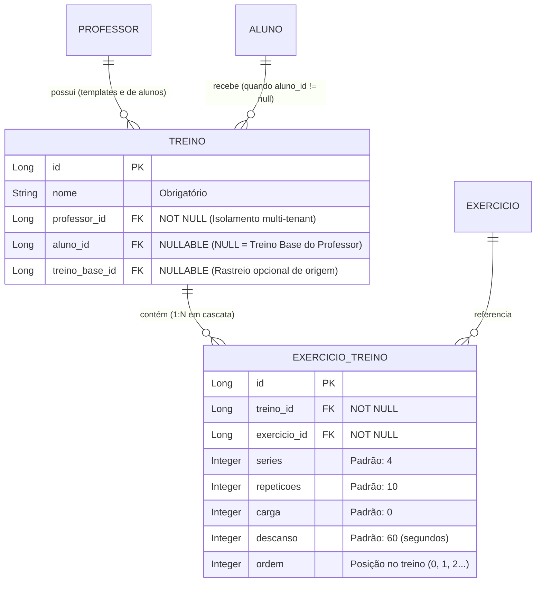

# 🏋️ Plano de Ação: Criação de Treinos (Base do Professor e por Aluno)

Este documento define a arquitetura, modelagem de banco de dados, contratos de DTOs, regras de negócio (`Service`) e endpoints (`Controller`) para a funcionalidade de **Criação de Treinos** na API, seguindo a lógica do aplicativo (`DOCUMENTACAO_TREINOS_E_EXERCICIOS.md`) adaptada para o contexto multi-professor e multi-aluno.

---

## 🧠 1. Decisão Arquitetural: Treino Base vs. Treino do Aluno

No aplicativo mobile offline, a tabela `treinos` existe para um único usuário local. Na API, um **Professor** gerencia múltiplos **Alunos** e precisa de agilidade para:
1. Criar **Treinos Base (Templates)** na sua biblioteca pessoal (ex: *"Adaptação Iniciante A"*, *"Hipertrofia Intermediário - Peito/Tríceps"*).
2. Criar um treino **do zero** diretamente para um aluno específico.
3. **Vincular um Treino Base** a um ou mais alunos.

### Por que usar Clonagem (Deep Copy) ao vincular um Treino Base a um Aluno?
Se o vínculo entre um Treino Base e o Aluno fosse apenas uma referência na mesma linha do banco (`N:N`), qualquer ajuste individual que o professor fizesse depois para o "Aluno João" (ex: mudar a carga do Supino de 20kg para 30kg ou trocar um exercício por dor articular) alteraria o treino de todos os outros alunos que usam aquela base.

Portanto, a melhor abordagem é:
- Todo registro em `treinos` pertence obrigatoriamente a um `Professor` (`professor_id NOT NULL`).
- O campo `aluno_id` em `treinos` passa a ser **opcional (`NULLABLE`)**:
  - **`aluno_id == NULL`** 👉 É um **Treino Base (Template)** do Professor.
  - **`aluno_id != NULL`** 👉 É um **Treino exclusivo daquele Aluno**.
- Opcionalmente, guardamos `treino_base_id` (`NULLABLE`) apenas para histórico/rastreabilidade de qual template originou aquele treino.



---

## 🛠️ 2. Ajustes nas Entidades (`domain/model`)

### 2.1. `Treino.java` #OK
Adicionar o vínculo obrigatório com `Professor` e opcional com `Aluno`:
- `@ManyToOne(fetch = FetchType.LAZY) @JoinColumn(name = "professor_id", nullable = false) private Professor professor;`
- `@ManyToOne(fetch = FetchType.LAZY) @JoinColumn(name = "aluno_id") private Aluno aluno;` *(nullable = true)*
- `@Column(name = "treino_base_id") private Long treinoBaseId;` *(opcional, para saber se veio de um template)*
- Manter `@OneToMany(mappedBy = "treino", cascade = CascadeType.ALL, orphanRemoval = true)` em `exercicios` para salvar `Treino` + `ExercicioTreino` em uma única transação JPA.

### 2.2. `Exercicio.java` (Catálogo Híbrido) #OK
Conforme previsto no `BACKEND_SPEC.md`, vale garantir que `Exercicio` tenha:
- `@ManyToOne(fetch = FetchType.LAZY) @JoinColumn(name = "professor_id") private Professor professor;` (`NULL` = exercício padrão global do sistema; `NOT NULL` = exercício criado pelo próprio professor).
- *Observação:* Remover `unique = true` global da coluna `nome` ou torná-la única por `(nome, professor_id)` para que professores diferentes possam cadastrar exercícios personalizados sem colisão.

### 2.3. `AlunoRepository.java` #Porque por id aluno e Id professor sendo que Id aluno é unico? o mais correto seria uma lista paginada trazendo todos os alunos por idProfessor não??
Criar o repositório de `Aluno` (ainda não existente em `domain/repository`) com método de segurança:
- `Optional<Aluno> findByIdAndProfessorId(Long id, Long professorId);`

---

## 🚀 3. Como Resolver Tudo no Mesmo Endpoint (`POST /treinos`)
 -Nesse aqui eu discordo de vc, acho que o treino base deve ser como um template que o front da um get e faz o request para criar o treino pq? vincular um treino base em varios alunos, se cada um tem uma carga e tal, a base ficaria apenas para o professor montar no front, como um parametro, então seria um endpoint de criar treino, outro para criar exercicios, para o de criar treino passar apenas o id do exercicio para fazer a ligação e já colocar as cargas  
É totalmente possível (e muito limpo) usar **um único endpoint `POST /treinos`** para cobrir os **3 cenários** de criação, dependendo de como o JSON de entrada (`CriarTreinoRequest`) é enviado:

| Cenário | `alunoId` | `treinoBaseId` | `exercicios` | Comportamento do `TreinoService` |
| :--- | :---: | :---: | :---: | :--- |
| **1. Criar Treino Base (Template do Professor)** | `null` | `null` | `[...]` *(Obrigatório)* | Cria o treino vinculado apenas ao `Professor` logado (`aluno = null`). |
| **2. Criar Treino para Aluno do Zero** | `10` | `null` | `[...]` *(Obrigatório)* | Valida se o aluno `10` pertence ao `Professor` e cria o treino com os exercícios enviados. |
| **3. Vincular Treino Base a um Aluno (Clonagem Rápida)** | `10` | `5` | `null` *(ou customizado)* | Busca o Treino Base `5` do professor, clona seu nome e seus itens `ExercicioTreino` (ou usa a lista `exercicios`/`nome` se o professor tiver editado na tela antes de salvar) e salva para o aluno `10`. |

> [!TIP]
> **Múltiplos Alunos de uma vez (Bônus):** Se quiser permitir que o professor selecione um Treino Base e vincule a 5 alunos de uma só vez, podemos aceitar `alunoId` (ou `List<Long> alunosIds`) no request!

---

## 📦 4. Contratos de DTOs (`dto/request` e `dto/response`)

Seguindo a mesma estrutura do `DOCUMENTACAO_TREINOS_E_EXERCICIOS.md`:

### 4.1. Request DTOs (`dto/request/treino/`)

```java
public record CriarTreinoRequest(
    String nome, // Obrigatório nos cenários 1 e 2; opcional no cenário 3 (herda do treinoBase se omitido)
    Long alunoId, // NULL = Treino Base do Professor; Preenchido = Treino vinculado ao Aluno
    Long treinoBaseId, // Opcional: ID do treino base a ser clonado
    @Valid List<ExercicioTreinoItemRequest> exercicios // Obrigatório se treinoBaseId for null
) {}

public record ExercicioTreinoItemRequest(
    @NotNull Long exercicioId,
    @NotNull @Min(1) Integer series,      // Padrão no front: 4
    @NotNull @Min(1) Integer repeticoes,  // Padrão no front: 10
    @NotNull @Min(0) Integer carga,       // Padrão no front: 0
    @NotNull @Min(0) Integer descanso,    // Padrão no front: 60
    Integer ordem                         // Se null, usa o índice (0, 1, 2...) da lista
) {}
```

### 4.2. Response DTOs (`dto/response/treino/`)

```java
public record TreinoResponse(
    Long id,
    String nome,
    Long alunoId,
    String nomeAluno,
    boolean treinoBase, // true quando alunoId == null
    Long treinoBaseId,
    List<ExercicioTreinoResponse> exercicios
) {}

public record ExercicioTreinoResponse(
    Long id,
    Long exercicioId,
    String nomeExercicio,
    GrupoMuscular grupoMuscular,
    Integer series,
    Integer repeticoes,
    Integer carga,
    Integer descanso,
    Integer ordem
) {}
```

---

## ⚙️ 5. Camada de Serviço e Validação (`TreinoService` & `TreinoValidator`)

Seguindo o padrão que você já criou em `AuthController` / `RegisterValidator`:

### 5.1. Validações de Entrada e Negócio
1. **Autenticação:** Extrair o `Professor` autenticado via `@AuthenticationPrincipal Professor professor` no Controller (já injetado pelo seu `JwtAuthFilter`).
2. **Regra Condicional (`treinoBaseId` vs `nome`/`exercicios`):**
   - Se `treinoBaseId == null`:
     - `nome` não pode ser vazio (`@NotBlank`).
     - `exercicios` não pode ser vazio (`>= 1` exercício, igual à validação `handleSalvar` do app).
   - Se `treinoBaseId != null`:
     - O treino base deve existir e pertencer ao `Professor` logado (`findByIdAndProfessorId`).
     - Se `exercicios` não for enviado no JSON, copia todos os `ExercicioTreino` do treino base. Se for enviado, usa a lista enviada (permite que o professor carregue um treino base na tela, ajuste uma carga para aquele aluno e salve).
3. **Isolamento do Aluno (Multi-tenant):**
   - Se `alunoId != null`, buscar via `alunoRepository.findByIdAndProfessorId(alunoId, professor.getId())`. Se não encontrar, lançar exceção (`404 Not Found` / `403 Forbidden`) para impedir que um professor crie treino para o aluno de outro professor.
4. **Validação dos Exercícios (`ExercicioRepository`):**
   - Buscar todos os `exercicioId` informados de uma vez (`findAllById`) para evitar *N+1 queries*.
   - Verificar se todos existem (e se pertencem ao catálogo global ou ao professor logado).
5. **Ordenação Garantida:**
   - Percorrer a lista de exercícios atribuindo `ordem = (item.ordem() != null) ? item.ordem() : i` (exatamente como o loop `i = 0..N` do app).
6. **Persistência Atômica (`@Transactional`):**
   - Instanciar `Treino`, adicionar os objetos `ExercicioTreino` na lista `treino.getExercicios()` (com `et.setTreino(treino)`), e chamar `treinoRepository.save(treino)`. O `CascadeType.ALL` fará o `INSERT` em `treinos` e todos os `INSERT`s em `exercicio_treino` automaticamente.

---

## 🌐 6. Endpoints Sugeridos (`TreinoController`)

Focando apenas no módulo do **Professor** neste momento (sem a parte de exportação para o app ainda):

| Método | Rota | Descrição |
| :--- | :--- | :--- |
| **`POST`** | `/treinos` | **Endpoint Unificado de Criação:** Cria Treino Base (`alunoId = null`), cria Treino do Aluno do zero (`alunoId != null`), ou vincula/clona um Treino Base para um Aluno (`treinoBaseId != null`). |
| **`GET`** | `/treinos` | Lista os treinos do professor. Pode receber query param opcional `?alunoId=10` (lista treinos daquele aluno) ou `?apenasBase=true` (lista apenas os Treinos Base do professor). |
| **`GET`** | `/treinos/{id}` | Busca os detalhes completos de um treino (com a lista de exercícios ordenada por `ordem ASC`). |
| **`PUT`** | `/treinos/{id}` | Atualiza nome e sincroniza a lista de exercícios do treino (graças ao `orphanRemoval = true` do JPA, basta atualizar a coleção `treino.getExercicios()`, muito mais simples que os 3 passos manuais do SQLite!). |
| **`DELETE`** | `/treinos/{id}` | Exclui um treino (Base ou de Aluno) e remove seus vínculos em `exercicio_treino` em cascata. |

---

## ✅ 7. Sequência de Implementação (Quando formos codar)

1. **Passo 1 (Model & Repositories):**
   - Atualizar `Treino.java` (adicionar `professor`, `aluno` opcional e `treinoBaseId` opcional).
   - Criar `AlunoRepository.java` e adicionar métodos de busca segura em `TreinoRepository.java`.
2. **Passo 2 (DTOs):**
   - Criar `CriarTreinoRequest`, `ExercicioTreinoItemRequest`, `TreinoResponse` e `ExercicioTreinoResponse`.
3. **Passo 3 (Service & Validator):**
   - Implementar `TreinoService` com suporte aos 3 cenários no método `criarTreino(Professor professor, CriarTreinoRequest request)`.
4. **Passo 4 (Controller):**
   - Criar `TreinoController` recebendo `@AuthenticationPrincipal Professor professor`.
5. **Passo 5 (Seed / Cadastro de Exercícios):**
   - Garantir que existam exercícios no banco (ou endpoint básico de exercícios / seed dos 45 exercícios do `DOCUMENTACAO_TREINOS_E_EXERCICIOS.md`) para podermos testar a criação de treinos.
